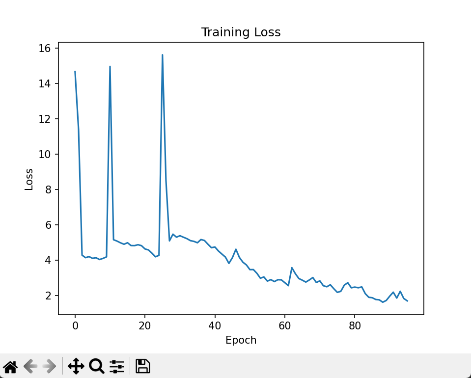
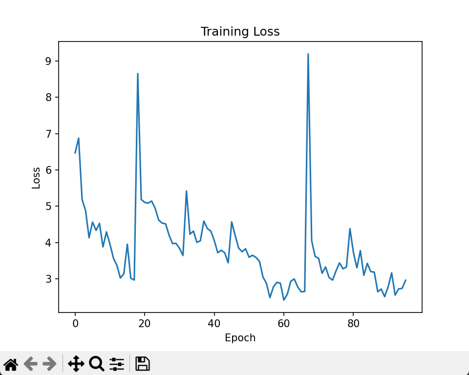
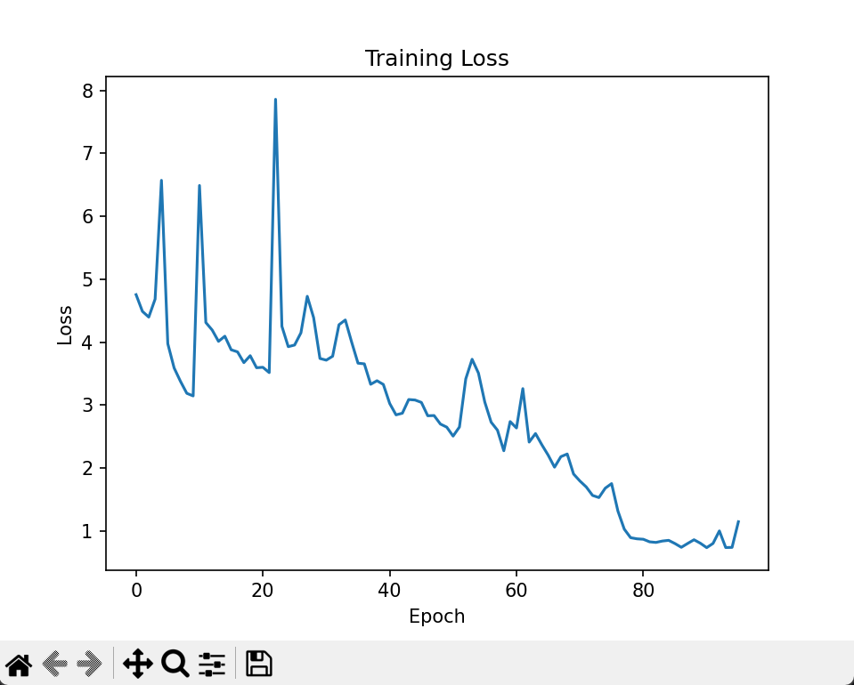
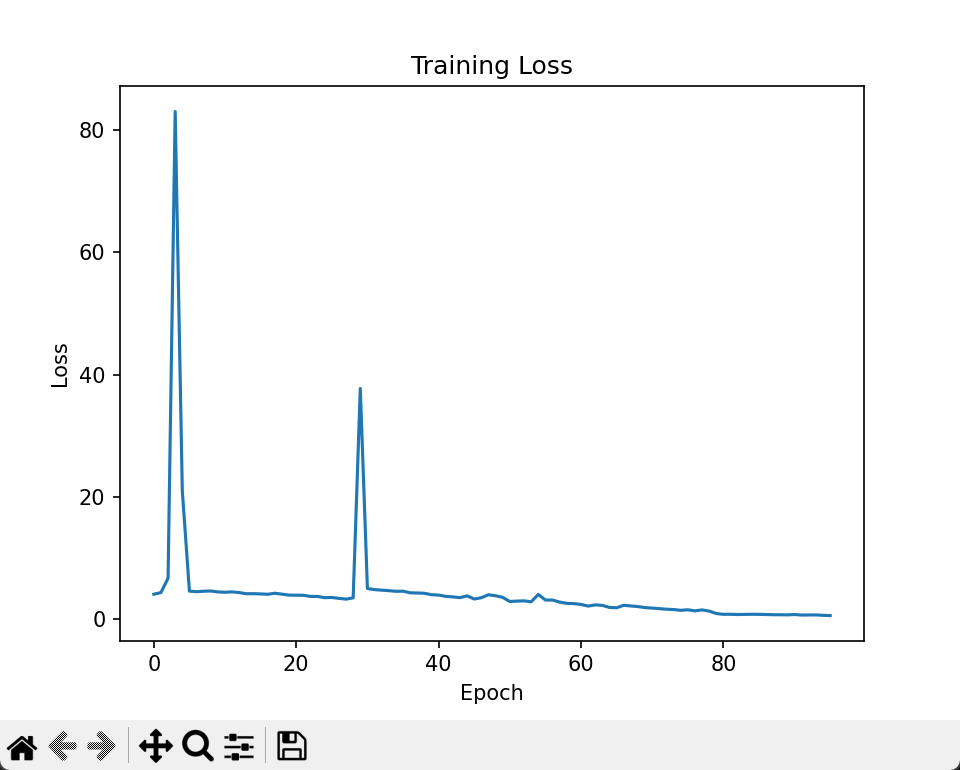
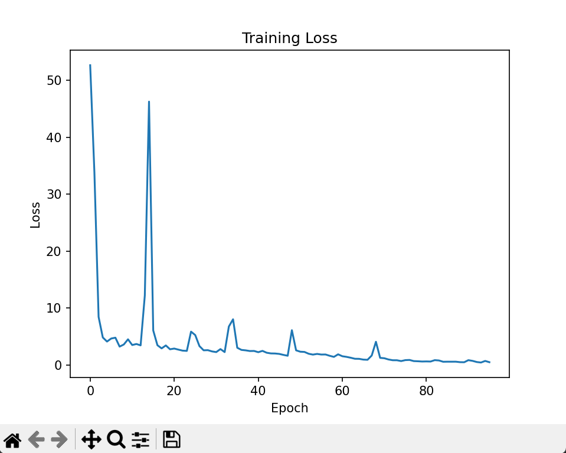

Seed=41 Accuracy=0.5556 Neg=0.5742 Neu=0.5328 Pos=0.5610

Seed=42 Accuracy=0.4400 Neg=0.5762 Neu=0.4212 Pos=0.3326

Seed=43 Accuracy=0.5444 Neg=0.3249 Neu=0.5556 Pos=0.7361

Seed=44 Accuracy=0.5714 Neg=0.4551 Neu=0.5065 Pos=0.7427

Seed=45 Accuracy=0.5799 Neg=0.3723 Neu=0.6094 Pos=0.7427

epoch=100 loss = loss_cls*(loss_mse**0.1)